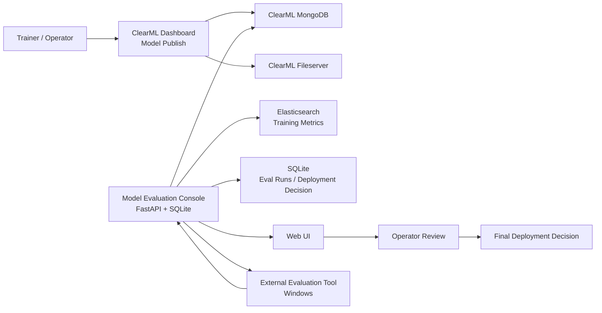

# ClearML Publish-Eval-Deploy Flow

## 1. 문서 목적

이 문서는 PPT 슬라이드 작성용 요약 문서다.
주요 목적은 아래 5단계를 한 번에 설명하는 것이다.

1. ClearML에서 모델 publish
2. Model Evaluation Console에서 publish 모델 감지 및 관리
3. 외부 평가툴로 평가 요청
4. 평가 결과 수신 및 화면 표시
5. 운영자 검토 후 최종 배포 판단

---

## 2. 전체 개요

현재 구성은 ClearML 서버와 별도의 Model Evaluation Console로 나뉜다.

- ClearML은 모델 학습, artifact 저장, publish 상태 관리의 원천 시스템이다.
- Model Evaluation Console은 publish 모델을 읽어서 운영 관점에서 관리하는 별도 오케스트레이션 화면이다.
- 외부 평가툴은 Windows 환경에서 실행되며, 모델 평가를 수행한 뒤 결과를 Console에 전달한다.
- 최종 배포 여부는 Console 화면에서 사람이 판단한다.

핵심 포인트:

- ClearML 자체를 수정하지 않고 Mongo/Elasticsearch 메타데이터를 읽는 방식으로 구현했다.
- 평가 워크플로우 상태는 Console 전용 SQLite에 저장한다.
- 평가 결과는 CSV 파일 또는 JSON 형태로 수신 가능하다.

---

## 3. 시스템 구성 요소

### 3.1 ClearML Server Stack

- ClearML Webserver
- ClearML Apiserver
- ClearML Fileserver
- MongoDB
- Elasticsearch
- Redis

역할:

- 모델/태스크 메타데이터 저장: MongoDB
- 학습 metric 저장: Elasticsearch
- 모델 파일 저장: Fileserver

### 3.2 Model Evaluation Console

- FastAPI 기반 웹 애플리케이션
- 포트: `8090`
- Docker Compose 서비스명: `model-eval-console`
- 내부 저장소: SQLite (`/opt/clearml/model_eval_console/data/console.db`)

역할:

- publish 모델 목록 구성
- 평가 요청 모드 관리 (`manual` / `auto`)
- 평가 요청 이력 관리
- 평가 결과 표시
- 최종 배포 판단 저장

### 3.3 External Evaluation Tool

- Windows 기반 평가 프로그램
- 모델별 평가 수행
- 결과를 CSV 또는 JSON으로 생성
- Console로 결과 전달

---

## 4. 아키텍처 다이어그램

설명:

- Console은 ClearML MongoDB와 Elasticsearch를 읽어 publish 모델 및 metric을 구성한다.
- Console은 자체 SQLite에 평가 상태와 배포 판단을 저장한다.
- 외부 평가툴은 Console과 결과를 주고받는다.

---

## 5. End-to-End 운영 플로우

### Step 1. 모델 Publish

- 사용자가 ClearML Dashboard에서 모델을 publish 한다.
- ClearML 쪽에는 publish 관련 task/model 메타데이터가 MongoDB에 기록된다.
- 모델 artifact는 ClearML Fileserver 경로에 위치한다.

### Step 2. Console이 publish 모델 감지

- Console 백엔드는 ClearML MongoDB를 폴링한다.
- 기본 주기는 `60초`다.
- 앱 시작 시 즉시 1회 동기화 후, 이후 주기적으로 동기화한다.

감지 기준:

- publish된 training task
- publish prefix 또는 publish marker를 가진 model 문서
- leaf project별 대표 publish 모델 1건 선택

### Step 3. 운영자가 publish 모델 확인

- Console 화면에서 publish 모델 목록을 표 형태로 확인한다.
- 프로젝트명, 모델명, artifact, publish 시각, 상태를 확인할 수 있다.
- 특정 모델을 선택하면 상세 정보와 학습 metric을 본다.

### Step 4. 외부 평가 요청 생성

평가 요청 방식은 2가지다.

- Manual 모드:
  - 운영자가 상세 화면에서 `평가 요청` 버튼 클릭
  - 해당 모델에 대한 평가 run이 생성됨
- Auto 모드:
  - 신규 publish 모델이 감지되면 자동으로 평가 run 생성

기본 큐 이름:

- `eval-windows`

### Step 5. 외부 평가툴이 모델 평가 수행

- 외부 평가툴은 모델 파일을 기반으로 평가 수행
- 평가 단위는 평가용 영상별 결과다.
- 각 영상에 대해 아래 항목을 산출한다.
  - TP
  - TN
  - FP
  - FN

### Step 6. 평가 결과를 Console로 전달

결과 수신 방식:

- CSV 파일 업로드
- JSON 직접 입력 또는 API 호출

지원 형식:

- CSV: 파일별 TP/TN/FP/FN + Average F1 Score + Average Accuracy
- JSON: `result_summary`, `metrics` 포함 가능

### Step 7. Console이 평가 결과를 시각화

- Latest Evaluation Result 영역에서 최신 평가 상태 확인
- 평가 결과 요약 표 표시
  - F1 Score
  - Accuracy
  - Precision
  - Recall
- 영상별 결과 표 표시
  - Filename
  - TP
  - TN
  - FP
  - FN

### Step 8. 최종 배포 판단

- 운영자가 평가 결과를 검토한다.
- 평가 완료 상태에서만 배포 판단 버튼이 활성화된다.
- 가능한 결정 값:
  - `deployed`
  - `hold`
  - `pending`

---

## 6. 현재 구현 상태

### 6.1 구현 완료

- ClearML publish 모델 자동 탐지
- 60초 주기 백그라운드 동기화
- publish 모델 목록/상세 화면
- 학습 metric 표시
- 평가 요청 모드 전환 (`manual`, `auto`)
- 수동 평가 요청 버튼
- 자동 평가 요청 생성
- CSV/JSON 평가 결과 수신
- 평가 결과 화면 표시
- 최종 배포 판단 버튼 및 상태 저장
- 다크/라이트 테마 전환

### 6.2 현재 전제

- Console 프론트가 열려 있지 않아도 백엔드는 계속 동작한다.
- publish 감지는 이벤트 기반이 아니라 폴링 기반이다.
- 평가툴과의 실시간 연동은 CSV/JSON 업로드 또는 API 전송으로 수용한다.

### 6.3 향후 보강 가능 항목

- ClearML publish 이벤트 기반 감지
- 외부 평가툴의 자동 callback 연동 고도화
- 평가 결과 표에서 FN/FP 강조 표시
- 배포 이력 관리
- 결과 리포트 다운로드

---

## 7. 데이터 저장 구조

### 7.1 ClearML 측 원본 데이터

- MongoDB
  - project
  - task
  - model
- Elasticsearch
  - training scalar metrics
- Fileserver
  - published model artifact 파일

### 7.2 Console 측 운영 데이터

- SQLite
  - `published_models`
  - `evaluation_runs`
  - `app_settings`
  - `model_review_state`

저장 목적:

- publish 모델 캐시
- 평가 요청/상태/결과 저장
- 자동/수동 모드 저장
- 최종 배포 판단 저장

---

## 8. 동기화 방식

현재 방식은 폴링이다.

- 앱 시작 시 즉시 1회 동기화
- 이후 `MODEL_EVAL_SYNC_INTERVAL_SEC` 주기마다 반복
- 기본값: `60초`

장점:

- 구현 단순
- ClearML 내부 변경 없이 동작
- 운영 안정성 높음

단점:

- publish 직후 최대 60초 지연 가능

대안:

- Mongo change stream 기반 이벤트 감지
- publish 스크립트에서 Console API 호출

---

## 9. 화면 구성 요약

### 9.1 상단 영역

- 평가 요청 모드 토글 (`Manual`, `Auto`)
- 테마 토글 (`Light`, `Dark`)
- 수동 동기화 버튼
- 현재 평가 요청 모드 설명

### 9.2 Published Models 표

- Project
- Model
- Artifact
- Published
- State

### 9.3 Model Detail

- publish 기본 정보
- 학습 metric 카드
- Evaluation Request 영역
- Latest Evaluation Result 영역
- Final Deployment Decision 영역

---

## 10. API / 연동 포인트

### 10.1 Console 내부 동작용

- `POST /sync-now`
- `POST /settings/evaluation-mode`
- `POST /models/{model_id}/request-eval`
- `POST /models/{model_id}/upload-result`
- `POST /models/{model_id}/deployment`

### 10.2 외부 평가툴 연동용

- `POST /api/models/{model_id}/result`
  - JSON 결과 업로드
- `POST /api/bridge/claim-next`
  - 평가 run 할당
- `POST /api/bridge/callback`
  - 상태/결과 callback

---

## 11. PPT 슬라이드 권장 구성

### Slide 1. 프로젝트 목적

- ClearML publish 모델을 운영 관점에서 관리
- 외부 평가 수행 결과를 수집
- 최종 배포 판단까지 연결

### Slide 2. 전체 운영 플로우

- Publish -> Detect -> Request Eval -> Receive Result -> Review -> Deploy

### Slide 3. 시스템 아키텍처

- ClearML / Console / External Evaluator / SQLite / Fileserver / Mongo / Elasticsearch 관계도

### Slide 4. Publish 모델 감지 방식

- ClearML Mongo polling
- 60초 주기
- project/task/model 기반 대표 모델 선정

### Slide 5. Console 주요 화면

- 상단 모드 제어
- publish 모델 목록
- 모델 상세 / metric / 결과 / 배포 판단

### Slide 6. 외부 평가 요청 흐름

- Manual / Auto 모드
- 평가 run 생성
- Windows 평가툴 연계

### Slide 7. 평가 결과 수신 및 표시

- CSV / JSON 입력
- TP/TN/FP/FN 표
- F1 / Accuracy 요약 표

### Slide 8. 최종 배포 판단

- 평가 완료 후 운영자 승인
- `deployed / hold / pending`

### Slide 9. 현재 구현 범위와 향후 확장

- 구현 완료 항목
- 이벤트 기반 감지, 자동 callback 강화 등 향후 과제

---

## 12. 발표용 한 줄 메시지

"ClearML에서 publish된 모델을 별도 운영 콘솔에서 자동 감지하고, 외부 평가 결과를 수집·표시한 뒤, 운영자가 최종 배포 여부를 결정하는 워크플로우를 구축했다."